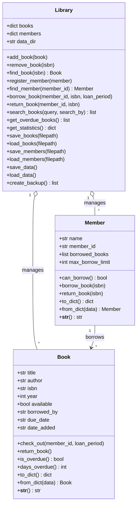

# Week 5: Object-Oriented Programming Basics

This repository contains the complete implementation for **Week 5: Object-Oriented Programming Basics** from **The Developers Arena**.

## UML Class Diagram (Step 1)



## Contents

1. **Hands-On Practice**: Located in [`hands_on_practice.py`](file:///c:/devolopers%20arena/Week-5-Object-Oriented-Programming-Basics/hands_on_practice.py).
   - `Student` class with name, age, and grade attributes
   - `BankAccount` class with deposit and withdraw methods
   - `PracticeBook` class with status property management
   - `Vehicle`, `Car`, and `Motorcycle` inheritance hierarchy
   - Multi-object instantiation examples

2. **Library Management System with OOP**: Located in [`week5-library-system/`](file:///c:/devolopers%20arena/Week-5-Object-Oriented-Programming-Basics/week5-library-system/).
   - `Book` class ([`book.py`](file:///c:/devolopers%20arena/Week-5-Object-Oriented-Programming-Basics/week5-library-system/library_system/book.py)): Checkout, return, overdue tracking, days overdue calculation, JSON serialization.
   - `Member` class ([`member.py`](file:///c:/devolopers%20arena/Week-5-Object-Oriented-Programming-Basics/week5-library-system/library_system/member.py)): Member details, borrow tracking, and 5-book limit enforcement.
   - `Library` class ([`library.py`](file:///c:/devolopers%20arena/Week-5-Object-Oriented-Programming-Basics/week5-library-system/library_system/library.py)): Collection management, book borrowing/returns, searches, statistics, file persistence, and backups.
   - Interactive Menu System ([`main.py`](file:///c:/devolopers%20arena/Week-5-Object-Oriented-Programming-Basics/week5-library-system/library_system/main.py)): Full terminal UI matching the reference specification.
   - Automated Unit Test Suite ([`tests/`](file:///c:/devolopers%20arena/Week-5-Object-Oriented-Programming-Basics/week5-library-system/tests/)): Unit tests for Book, Member, and Library classes.

## Execution

### Run Hands-On Practice
```bash
python hands_on_practice.py
```

### Run Library Management System
```bash
python week5-library-system/library_system/main.py
```

### Run Test Suite
```bash
python -m unittest discover -s week5-library-system/tests
```
