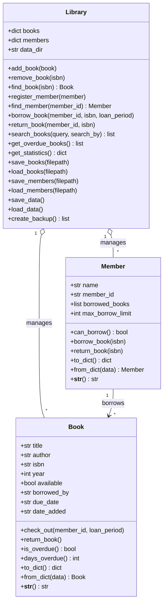

# Library Management System with OOP

A comprehensive library management system implemented in Python following Object-Oriented Programming (OOP) principles.

## UML Class Diagram



## Features

- **Class Architecture:**
  - `Book`: Manages book metadata, checkout/return states, overdue tracking, serialization (`to_dict`/`from_dict`), and display formatting.
  - `Member`: Manages member profile, active borrowed list, maximum borrow limit enforcement (default 5 books), and serialization.
  - `Library`: Manages collections of books and members, lending transactions, searches, statistics, file persistence, and backups.
- **Search Capabilities:** Search by Title, Author, ISBN, or filter all available books.
- **Overdue Calculations:** Real-time calculation of overdue status and elapsed overdue days.
- **Data Persistence & Backups:** Automatic loading and saving with JSON storage in `data/`, along with timestamped backups in `data/backup/`.
- **Interactive CLI:** Full-featured console menu with input validation and clear status reporting.

## Project Structure

```text
week5-library-system/
├── library_system/
│   ├── __init__.py
│   ├── book.py
│   ├── member.py
│   ├── library.py
│   └── main.py
├── data/
│   ├── books.json
│   ├── members.json
│   └── backup/
├── tests/
│   ├── test_book.py
│   ├── test_member.py
│   └── test_library.py
├── requirements.txt
├── README.md
└── .gitignore
```

## Getting Started

### Prerequisites
- Python 3.8 or higher

### Running the Application

From within the `week5-library-system` folder:
```bash
python library_system/main.py
```

### Running Tests

Execute all unit tests using Python's built-in `unittest` runner:
```bash
python -m unittest discover -s tests
```
